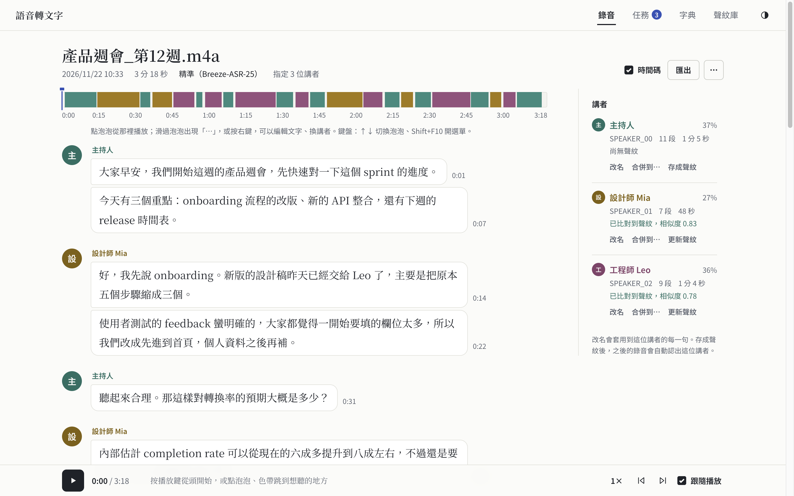
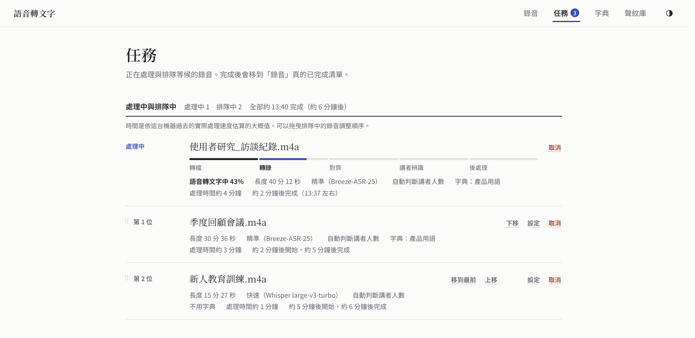
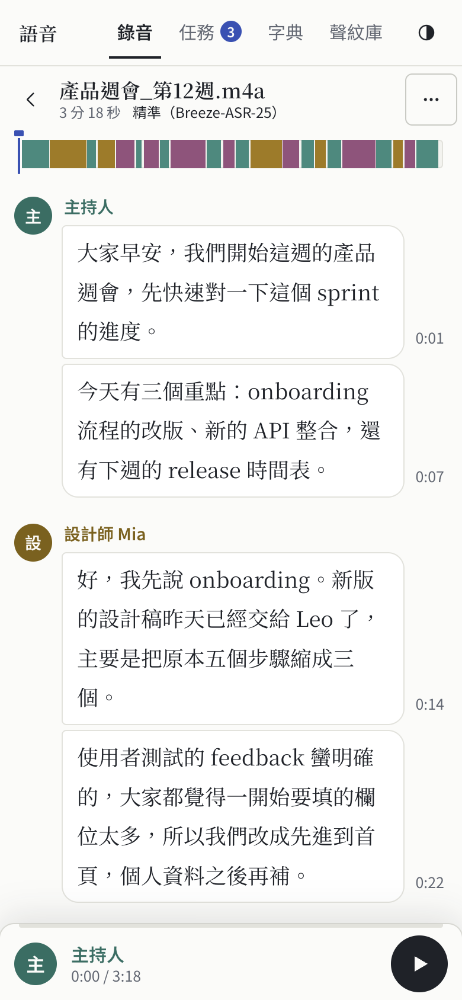

<div align="right"><strong>English</strong> · <a href="README.zh-TW.md">繁體中文</a></div>

# voice-to-text

[](https://github.com/yftan945/voice-to-text/releases)
[](https://github.com/yftan945/voice-to-text/commits)
[](LICENSE)


A self-hosted speech-to-text web app. Upload a recording or paste a YouTube link and get a transcript from your own GPU, with Mandarin–English code-switching, automatic speaker labels, a voiceprint library that remembers the people you record, an editor that follows playback, and subtitle export. Audio and transcripts stay on your machine. Nothing is sent to the cloud.

The interface is in Traditional Chinese (Taiwan).



## Features

- **Mandarin + English in the same sentence**: [Breeze-ASR-25](https://huggingface.co/MediaTek-Research/Breeze-ASR-25) by default (a Whisper fine-tune for Taiwanese Mandarin and code-switching). Whisper large-v3 and large-v3-turbo are also available. WhisperX adds word-level timestamps. Output uses Taiwanese Traditional Chinese with full-width punctuation.
- **Speaker diarization**: pyannote finds who spoke when. Each word gets a speaker, and sentences are split where the speaker changes.
- **Voiceprint library**: enroll a voice once, and later recordings label that speaker by name.
- **Dictionaries**: terms are passed to the model as hints, and mishearings are replaced with the correct spelling. When you correct a word in a transcript, you can add the fix to a dictionary in one click.
- **YouTube**: paste a video or playlist link. If the video has human-made captions, the app uses them and still labels speakers. Otherwise the selected model transcribes it.
- **Background queue**: upload many files at once and close the tab while they process. You see live progress, queue position and an estimated finish time. Queued jobs can be reordered, and their settings can be changed before they start.
- **Edit while you listen**: click the speaker timeline to jump to a point, or click a line to play from there. Edit text, reassign or merge speakers. The original result is kept, so you can revert in one click.
- **Export**: TXT, Markdown, SRT, VTT, JSON.
- **Mobile-friendly**: responsive layout with a pull-up player panel, in light and dark themes.

<p align="center">
  
  &nbsp;
  
</p>

## Requirements

- A Linux host with an NVIDIA GPU. 12 GB of VRAM or more is recommended (developed and tested on an RTX 4070 Ti 12GB).
- Docker with `docker compose` 2.24 or later, plus the [NVIDIA Container Toolkit](https://docs.nvidia.com/datacenter/cloud-native/container-toolkit/latest/install-guide.html).
- A [Hugging Face](https://huggingface.co/) read token, with the terms accepted for [`pyannote/speaker-diarization-community-1`](https://huggingface.co/pyannote/speaker-diarization-community-1). Speaker labels need it. Without a token you still get a transcript, just without speakers.

## Quick start

```bash
git clone https://github.com/yftan945/voice-to-text.git
cd voice-to-text

cp .env.example .env && chmod 600 .env
# Edit .env:
#   HF_TOKEN=hf_...          Hugging Face read token
#   BIND_IP=192.168.1.10     the host's LAN IP (127.0.0.1:8810 is always bound; don't use 127.0.0.1 here)

docker compose up -d --build          # the first build installs PyTorch and friends, so it takes a while
curl http://127.0.0.1:8810/healthz    # {"status":"ok","worker":"alive"}
```

Open `http://<BIND_IP>:8810/` in a browser. Each model downloads to `./models` the first time it is used. Audio, transcripts and the SQLite database are stored in `./data`.

### Enable Breeze-ASR-25 (recommended)

Breeze-ASR-25 needs a one-time conversion to the CTranslate2 format. Until you convert it, the app uses Whisper large-v3.

```bash
docker compose exec app ct2-transformers-converter \
  --model MediaTek-Research/Breeze-ASR-25 \
  --output_dir /models/ct2/breeze-asr-25-f16 \
  --quantization float16 --low_cpu_mem_usage \
  --copy_files tokenizer.json preprocessor_config.json
docker compose restart app
```

### Update

```bash
git pull && docker compose up -d --build
```

Rebuilding restarts the container. A job interrupted mid-transcription goes back to the front of the queue when the container restarts, but it's best to update when the queue is empty.

## Configuration

Set these environment variables in `.env`:

| Variable | Default | Description |
|---|---|---|
| `HF_TOKEN` | (empty) | Hugging Face read token, needed for speaker labels |
| `BIND_IP` | (required) | LAN IP to bind. `127.0.0.1:8810` is always bound as well |
| `DEFAULT_MODEL` | `breeze-asr-25` | `breeze-asr-25`, `large-v3-turbo` or `large-v3`. Falls back to large-v3 if the chosen model isn't installed |
| `BREEZE_MODEL_PATH` | `/models/ct2/breeze-asr-25-f16` | CTranslate2 directory for Breeze-ASR-25 |
| `ASR_LANGUAGE` | (empty = auto) | Force a language, such as `zh`. English passages are then translated into Chinese |
| `ASR_MULTILINGUAL` | `1` | Detect the language for each 30-second window, for recordings that switch languages |
| `ASR_INITIAL_PROMPT` | (empty) | Extra prompt, passed to the model along with dictionary terms |
| `ASR_BEAM_SIZE` | `5` | Beam size |
| `ASR_COMPUTE_TYPE` | `float16` | GPU compute precision |
| `DIARIZATION_MODEL` | `pyannote/speaker-diarization-community-1` | Diarization pipeline |
| `EMBEDDING_MODEL` | `pyannote/wespeaker-voxceleb-resnet34-LM` | Voiceprint embedding model |
| `VOICEPRINT_THRESHOLD` | `0.55` | Similarity threshold for matching voiceprints |
| `IDLE_UNLOAD_SECONDS` | `600` | Idle time before models are unloaded to free VRAM |
| `MAX_UPLOAD_MB` | `2048` | Upload size limit |

> There is no login. Run the app only on a network you trust, and don't expose it directly to the internet.

## Architecture

```
Browser (React 19 + Vite + TypeScript)
   │  REST + SSE
   ▼
FastAPI (single container) ──── SQLite: queue, transcripts, dictionaries, voiceprints
   │
   └─ GPU worker (one job at a time)
        yt-dlp download (YouTube) → ffmpeg to 16 kHz WAV
        → faster-whisper transcription → WhisperX word alignment
        → pyannote diarization → per-word speaker assignment, sentence split
        → voiceprint matching → Traditional Chinese conversion, punctuation, dictionary
```

For the processing pipeline, API, frontend structure, design decisions and known limitations, see [docs/architecture.md](docs/architecture.md) (in Traditional Chinese).

## Try the demo (no GPU)

`scripts/demo.sh` runs the full web interface with made-up sample data (a product meeting with three speakers, a task queue, a dictionary and voiceprints), so you can look around before setting up a GPU host. It needs Docker, Node.js and ffmpeg. No models are loaded and nothing is transcribed.

```bash
scripts/demo.sh          # build the frontend, seed sample data, serve at http://127.0.0.1:8899
scripts/demo.sh stop
```

## Development

```bash
# Backend tests (no GPU needed)
docker run --rm -v "$PWD/backend":/src -w /src python:3.12-slim \
  sh -c "pip install -q -r requirements-dev.txt && python -m pytest -q tests"

# Frontend
cd frontend && npm ci && npm run typecheck && npm run build
VITE_API=http://<BIND_IP>:8810 npm run dev   # local dev server, API proxied to the GPU host
```

## Acknowledgements

- [Breeze-ASR-25](https://huggingface.co/MediaTek-Research/Breeze-ASR-25), [faster-whisper](https://github.com/SYSTRAN/faster-whisper), [WhisperX](https://github.com/m-bain/whisperX), [pyannote.audio](https://github.com/pyannote/pyannote-audio), [OpenCC](https://github.com/BYVoid/OpenCC), [yt-dlp](https://github.com/yt-dlp/yt-dlp)
- Dictionary syntax borrowed from [Umless](https://github.com/jatinbishla/Umless)

## License

[MIT](LICENSE)
