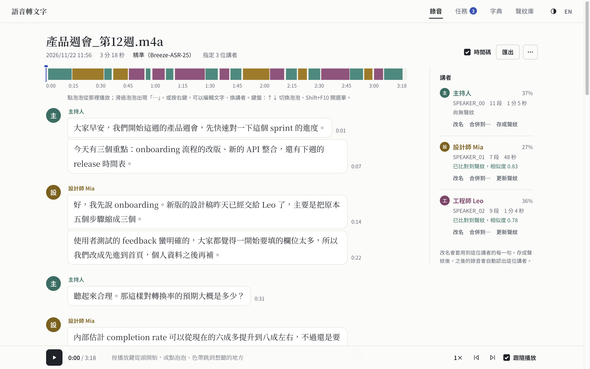
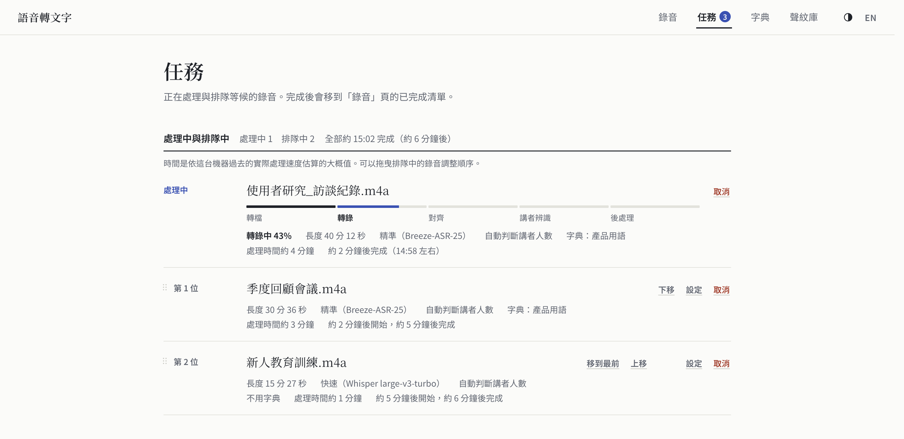
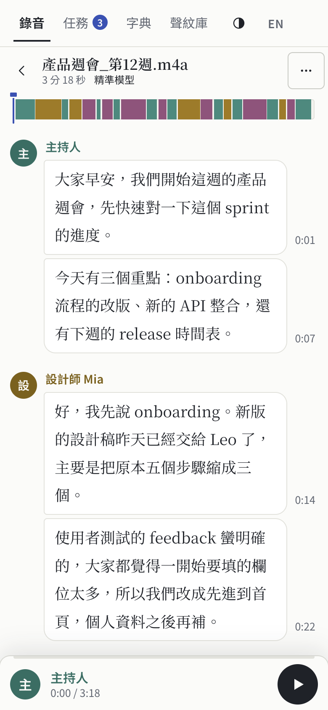

<div align="right"><a href="README.md">English</a> · <strong>繁體中文</strong></div>

# voice-to-text

[](https://github.com/yftan945/voice-to-text/releases)
[](https://github.com/yftan945/voice-to-text/commits)
[](LICENSE)


自己架設的語音轉文字網站。上傳錄音或貼上 YouTube 網址，在自己的 GPU 上轉成逐字稿：國語＋英文夾雜、自動分辨講者、記得常出現的人，還能邊聽邊改、匯出字幕。音檔與逐字稿都留在你的機器上，不會傳到雲端。



## 功能

- **國語＋英文夾雜辨識**：預設使用 [Breeze-ASR-25](https://huggingface.co/MediaTek-Research/Breeze-ASR-25)（針對台灣國語與中英夾雜微調的 Whisper），也可以選 Whisper large-v3／large-v3-turbo；WhisperX 逐字對齊時間。輸出台灣繁體中文與全形標點。
- **多人講者辨識**：pyannote 自動分段，逐字指派講者並在換人處切句。
- **聲紋庫**：登記一段聲音，之後的錄音自動標上真名。
- **字典**：專有名詞當辨識提示，誤聽自動替換成正字；在逐字稿改字後，可以一鍵把「錯字 → 正字」加進字典。
- **YouTube**：貼影片或播放清單網址，有人工字幕就直接用字幕（一樣會辨識講者），沒有就用模型轉錄。
- **背景佇列**：一次上傳多個檔案，關掉頁面也會繼續處理；即時顯示進度、排隊順位與預估完成時間，排隊中的任務可以調整順序或修改設定。
- **邊聽邊改**：講者色帶可以點擊跳轉，點泡泡從那句開始播放；可以改字、改講者、合併講者，原始結果保留，可以一鍵還原。
- **匯出**：TXT、Markdown、SRT、VTT、JSON。
- **中英文介面**：導覽列可以切換繁體中文與英文，預設跟隨瀏覽器語言；錯誤訊息與匯出檔也會跟著換語言。
- **手機也能用**：RWD 版面、上拉式播放面板，支援淺色與深色。

<p align="center">
  
  &nbsp;
  
</p>

## 系統需求

- Linux 主機＋NVIDIA GPU，建議 12 GB 以上 VRAM（開發與實測使用 RTX 4070 Ti 12GB）
- Docker 與 `docker compose` 2.24 以上，並安裝 [NVIDIA Container Toolkit](https://docs.nvidia.com/datacenter/cloud-native/container-toolkit/latest/install-guide.html)
- [HuggingFace](https://huggingface.co/) 帳號與 read token，並在模型頁面同意 [`pyannote/speaker-diarization-community-1`](https://huggingface.co/pyannote/speaker-diarization-community-1) 的使用條款（講者辨識需要；沒有 token 時仍會輸出不分講者的逐字稿）

## 快速開始

```bash
git clone https://github.com/yftan945/voice-to-text.git
cd voice-to-text

cp .env.example .env && chmod 600 .env
# 編輯 .env：
#   HF_TOKEN=hf_...          HuggingFace read token
#   BIND_IP=192.168.1.10     主機的內網 IP（127.0.0.1:8810 已固定開放，這裡不要填 127.0.0.1）

docker compose up -d --build          # 第一次建置要裝 PyTorch 等套件，需要一段時間
curl http://127.0.0.1:8810/healthz    # {"status":"ok","worker":"alive"}
```

用瀏覽器開啟 `http://<BIND_IP>:8810/`。模型第一次用到時才會下載，存在 `./models`。音檔、逐字稿與 SQLite 資料庫存在 `./data`。

### 啟用 Breeze-ASR-25（建議）

Breeze-ASR-25 要先轉成 CTranslate2 格式。還沒轉檔時，網站會改用 Whisper large-v3。

```bash
docker compose exec app ct2-transformers-converter \
  --model MediaTek-Research/Breeze-ASR-25 \
  --output_dir /models/ct2/breeze-asr-25-f16 \
  --quantization float16 --low_cpu_mem_usage \
  --copy_files tokenizer.json preprocessor_config.json
docker compose restart app
```

### 更新

```bash
git pull && docker compose up -d --build
```

重建會重啟容器，轉錄到一半的任務會中斷，重啟後自動排回佇列最前面。最好等任務都完成再更新。

## 設定

環境變數寫在 `.env`：

| 變數 | 預設 | 說明 |
|---|---|---|
| `HF_TOKEN` | （空） | HuggingFace read token，講者辨識需要 |
| `BIND_IP` | （必填） | 服務綁定的內網 IP，另外固定開放 `127.0.0.1:8810` |
| `DEFAULT_MODEL` | `breeze-asr-25` | 預設模型：`breeze-asr-25`／`large-v3-turbo`／`large-v3`。選的模型沒安裝時改用 large-v3 |
| `BREEZE_MODEL_PATH` | `/models/ct2/breeze-asr-25-f16` | Breeze-ASR-25 的 CTranslate2 目錄 |
| `ASR_LANGUAGE` | （空＝自動偵測） | 指定語言，例如 `zh`。指定後英文段落會被翻成中文 |
| `ASR_MULTILINGUAL` | `1` | 每 30 秒各自偵測語言，適合中英段落交錯的錄音 |
| `ASR_INITIAL_PROMPT` | （空） | 額外的提示句，與字典詞彙一起帶入 |
| `ASR_BEAM_SIZE` | `5` | beam size |
| `ASR_COMPUTE_TYPE` | `float16` | GPU 計算精度 |
| `DIARIZATION_MODEL` | `pyannote/speaker-diarization-community-1` | 講者分段模型 |
| `EMBEDDING_MODEL` | `pyannote/wespeaker-voxceleb-resnet34-LM` | 聲紋 embedding 模型 |
| `VOICEPRINT_THRESHOLD` | `0.55` | 聲紋比對的相似度門檻 |
| `IDLE_UNLOAD_SECONDS` | `600` | 模型閒置多久後卸載、釋放 VRAM |
| `MAX_UPLOAD_MB` | `2048` | 上傳大小上限 |

> 網站沒有登入機制，請只在信任的區網內使用，不要直接開放到網際網路。

## 架構

```
瀏覽器（React 19 + Vite + TypeScript）
   │  REST + SSE
   ▼
FastAPI（單一容器）──── SQLite：任務佇列、逐字稿、字典、聲紋
   │
   └─ GPU worker（一次處理一個任務）
        yt-dlp 下載（YouTube）→ ffmpeg 轉 16kHz WAV
        → faster-whisper 轉錄 → WhisperX 逐字對齊
        → pyannote 講者分段 → 逐字指派講者、切句
        → 聲紋比對 → 繁體轉換、全形標點、字典替換
```

處理流程、API、前端結構、設計決定與已知限制見 [docs/architecture.md](docs/architecture.md)。

## 試用示範（不需要 GPU）

`scripts/demo.sh` 會用虛構的示範資料（一場三人的產品週會、任務佇列、字典與聲紋）啟動完整的網頁介面，還沒準備 GPU 主機也能先看看。需要 Docker、Node.js 與 ffmpeg。不載入模型，也不會真的轉錄。

```bash
scripts/demo.sh          # 建置前端、塞入示範資料，在 http://127.0.0.1:8899 開啟
scripts/demo.sh stop
```

## 開發

```bash
# 後端測試（不需要 GPU）
docker run --rm -v "$PWD/backend":/src -w /src python:3.12-slim \
  sh -c "pip install -q -r requirements-dev.txt && python -m pytest -q tests"

# 前端
cd frontend && npm ci && npm run typecheck && npm run build
VITE_API=http://<BIND_IP>:8810 npm run dev   # 本機開發，API 轉到 GPU 主機上的服務
```

## 致謝

- [Breeze-ASR-25](https://huggingface.co/MediaTek-Research/Breeze-ASR-25)、[faster-whisper](https://github.com/SYSTRAN/faster-whisper)、[WhisperX](https://github.com/m-bain/whisperX)、[pyannote.audio](https://github.com/pyannote/pyannote-audio)、[OpenCC](https://github.com/BYVoid/OpenCC)、[yt-dlp](https://github.com/yt-dlp/yt-dlp)
- 字典語法參考 [Umless](https://github.com/jatinbishla/Umless)

## 授權

[MIT](LICENSE)
